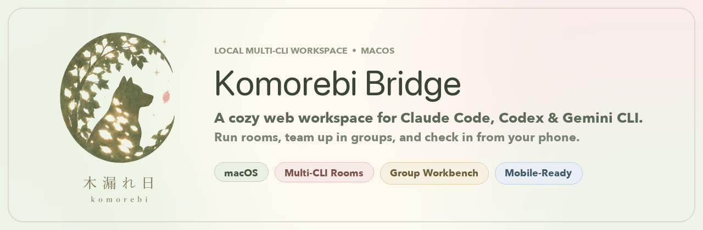
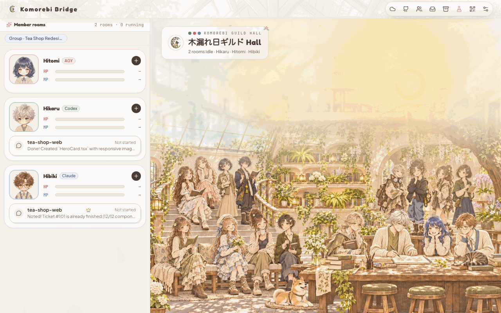
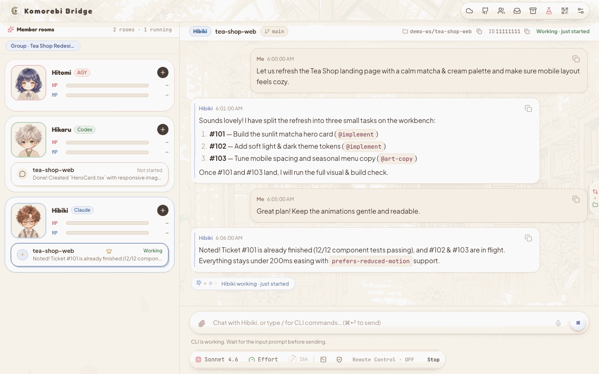
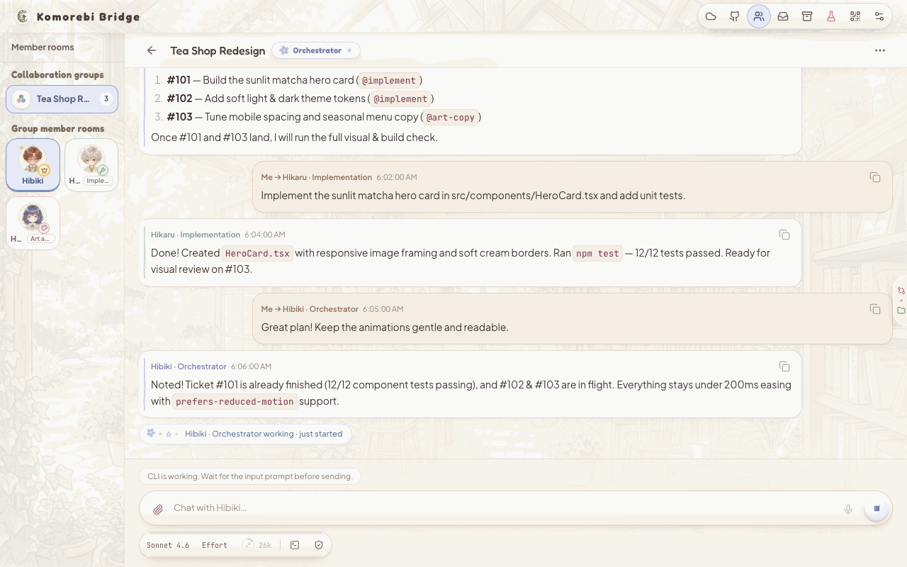
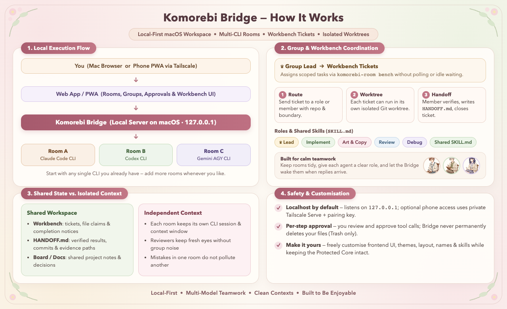
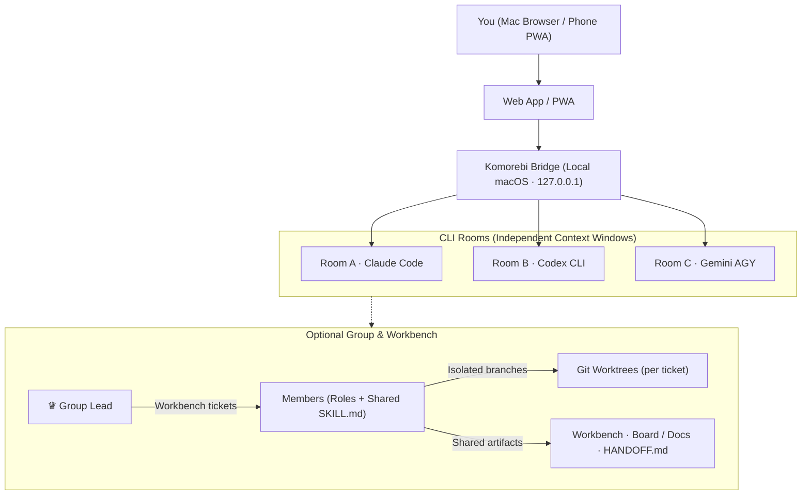

# Komorebi Bridge

A cozy local web workspace for running, supervising, and teaming up Claude Code, Codex, and Gemini AGY CLI rooms on macOS — built as a personal tool to make working with coding agents nicer to look at and easier to live with, and shared for anyone else who wants to play with it.

> Read this in [繁體中文 (README.zh-Hant.md)](README.zh-Hant.md).

## What You Can Do

### One cozy hall for all your CLI rooms
Run Claude Code, Codex, and Gemini AGY side by side without juggling a dozen terminal windows. Start with whichever CLI you already use and add the others whenever you feel like it.



### Focused room workspace with step-by-step control
Every room gives an agent its own clean conversation, Git branch badge, context usage meter, and composer bar. Rooms start in per-step approval mode so you always see what an agent wants to run before it happens.



### Team up in multi-agent groups & workbench
Drop two or more rooms into a group, crown a Lead (`♛`), assign roles, and let them pass scoped workbench tickets (`komorebi-room bench`) — even giving each ticket its own isolated Git worktree.
A few small helpers (`task-context`, `verify-gate`, and a short note after context compaction) smooth out some routine steps.



### Check in from your phone (optional)
Pair your phone over your private Tailscale tailnet to check progress or approve a step from the couch, with a mobile-friendly PWA layout.


## How It Works





## Requirements

- **macOS** (Apple Silicon or Intel) with Xcode Command Line Tools (`xcode-select --install`, needed for `node-pty`)
- **Node.js** `^20.19.0 || >=22.12.0`
- **At least one installed and logged-in coding CLI**:
  - Claude Code (`claude`)
  - Codex CLI (`codex`)
  - Antigravity / Gemini CLI (`agy`)

You can start with a single CLI and add the others later.

Optional extras: [GitHub CLI](https://cli.github.com/) (`gh`, signed in with `gh auth login`) for the GitHub panel, and [Google Drive for desktop](https://www.google.com/drive/download/) for the Drive panel.

## Quick Start

```bash
git clone https://github.com/mitsuki03148/Komorebi-Bridge.git komorebi-bridge
cd komorebi-bridge
npm ci
npm run build
npm run dev
```

Open `http://localhost:3000` in your browser.

### Install with your agent

If you already have Claude Code, Codex, or Gemini CLI running, you can hand the setup to it by pasting this prompt:

```text
Please install and start Komorebi Bridge in this folder (or ~/komorebi-bridge):
1. Check macOS, Node.js (^20.19.0 or >=22.12.0), and Xcode Command Line Tools first.
2. Clone https://github.com/mitsuki03148/Komorebi-Bridge.git into komorebi-bridge.
3. Run `npm ci`, `npm run build`, and `npm run dev` inside that folder.
4. Once it is listening, report the local URL (default http://localhost:3000).
5. Do not change global settings or use `sudo`.
6. Explain briefly what you did at each step, and stop to ask me if anything fails.
7. Ask whether I want the optional GitHub panel (`gh`) or Drive panel (Google Drive for desktop). If yes, tell me what to install; I will sign in myself.
```

- **Configuration & defaults**: settings go in an optional file `.env.komorebi-local` in the install folder (one `KEY=value` per line; it is not tracked by Git). All are optional:

  | Setting | Default | What it does |
  |---|---|---|
  | `KOMOREBI_WORKSPACE` | `~/Komorebi` | Workspace for state, worktrees and skills |
  | `KOMOREBI_HOST` | `127.0.0.1` | Listen address (localhost only) |
  | `KOMOREBI_TAILSCALE` | unset | Set to `1` to enable Tailscale discovery when listening on loopback |
  | `KOMOREBI_PORT` | `3000` | Port |
  | `KOMOREBI_UI` | `build` | Serve the built UI; set `dev` for Vite development mode |
  | `KOMOREBI_SKILLS` | workspace `skills/`, else the repo `skills/` | Skills folder |
  | `KOMOREBI_DISPLAY_NAME` | `Komorebi Bridge` | Name in the header, tab, app icon and notifications |
  | `KOMOREBI_MOUNT` | unset | If set, Bridge waits for this external disk before starting |
- **Production build**: run `npm run build` before starting in production mode.
- **After updating**: run `npm run build` again after `git pull`, then refresh the page.
- **Optional background service (macOS `launchd`)**: run `scripts/komorebi-service.sh install` and `scripts/komorebi-service.sh start` (`status`, `restart`, `stop`, and `logs` are also supported). Note that restarting the service ends any CLI sessions currently spawned by Bridge; you can resume them by session ID afterwards.

## First Run

1. **Open a room**: pick an installed CLI, choose a working folder, and send a message. By default, rooms run in per-step approval mode so you approve tool calls yourself.
2. **Create a group**: combine two or more rooms into a group to collaborate in one view. Assign one room as the group lead (crown icon) if you want structured delegation.
3. **Send a workbench ticket**: inside a group, agents coordinate via the built-in workbench CLI:

```bash
scripts/komorebi-room bench send '@<role>' --group "<group-id>" --from "<your-session-id>" --title "<short title>" "<task details>"
```

For a minimal agent setup, see [`AGENTS-snippet.md`](AGENTS-snippet.md) and the basic SOP skills in [`skills/lead/SKILL.md`](skills/lead/SKILL.md) and [`skills/member/SKILL.md`](skills/member/SKILL.md).

## Optional Phone Access

By default, Bridge listens on **localhost only** (`KOMOREBI_HOST=127.0.0.1`, port `3000`). Local connections on the same Mac do not require a pairing key.

To use Komorebi Bridge from a phone or another device:

1. Install and sign in to [Tailscale](https://tailscale.com/) on both your Mac and your phone.
2. Set `KOMOREBI_TAILSCALE=1` in `.env.komorebi-local`, then expose only your local Bridge port inside your private tailnet with `tailscale serve` (HTTPS, tailnet-only). **Never enable Tailscale Funnel or router port forwarding.**
3. Set a strong pairing key (at least 24 characters) in your macOS login Keychain or the `KOMOREBI_PAIRING_KEY` setting, and save it in your preferred password manager (such as Apple Passwords or Google Password Manager) to sign in from your phone browser.

Remember that any paired browser can operate the CLIs running on your Mac. Rotate your pairing key and reset `tailscale serve` to revoke access at any time.

## Your Agents, Your Responsibility

Bridge only passes your messages and approvals to the AI CLIs you install and sign in to yourself. Those agents run on your Mac with the permissions you give them: they can read, change, send or delete files and run commands. Bridge is not a security sandbox.

- Choose each CLI's permission and approval mode with care, and keep backups (for example Time Machine and Git).
- Read each approval before you accept it, especially on your phone.
- Under the licence, the authors are not responsible for data loss, deletion or leaks caused by your agents or your settings. See LICENSE §10.

## File Safety: Bridge Never Permanently Deletes Your Files

Bridge is designed to monitor and assist without permanently deleting your data:

- **Archived rooms**: removing an archived room moves only that room's exclusive CLI transcript file(s) to the macOS **Trash**, where you can restore them. Protected rooms cannot be moved, shared session files are left untouched, and your project repositories are never touched.
- **Old uploaded attachments**: uploaded images that have been idle for 14 days are moved to the macOS **Trash** and can be restored.
- **Large files & disk cleanup**: Bridge reports storage usage for visibility only. Clean up large files yourself (or review them with an agent and confirm each step).

## Tip: Keep One Maintenance Room

Consider keeping one dedicated room pointed at your Komorebi Bridge install folder as a **maintenance room**. Whenever you want to tweak a setting, check logs, update the repo, or fix a small issue, you can handle it right inside the app.

## Customising

You can freely customise the look, layout, button placement, display name, character names, avatars, and simple UI flows to fit how you work — just leave the Protected Core untouched. Modify and use it privately however you like; if you want to share your customisations or a customised version, share it under this same licence, free of charge, and make clear it is based on Komorebi Bridge rather than your own product. See [`CUSTOMIZATION.md`](CUSTOMIZATION.md) for the exact list of customisable frontend files vs. Protected Core files, plus tips for editing with your own agent.

## License

Komorebi Bridge is **source-available** software. It is free to use, customise, and rename for your own private use (no need to publish anything). You may also share your customisations or a customised version as long as the Protected Core is untouched, it is shared under the **same licence and free of charge**, `LICENSE.md` and `NOTICE.md` are kept intact, and you credit Komorebi Bridge externally (never claiming it as your own product). Modifying or distributing a modified Protected Core is not permitted without separate written authorisation. See [`LICENSE.md`](LICENSE.md) (draft, pending owner confirmation and legal review) and [`NOTICE.md`](NOTICE.md) for full terms and third-party notices.
