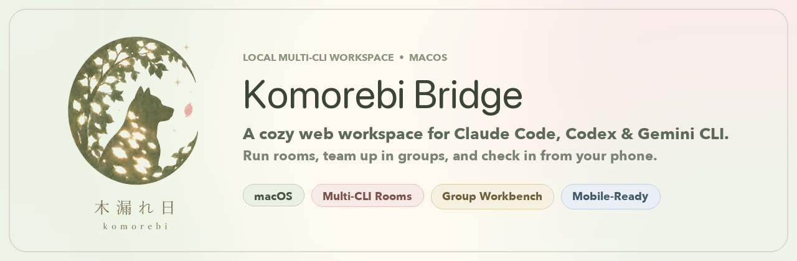
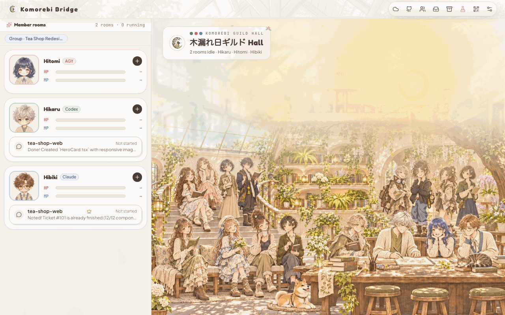
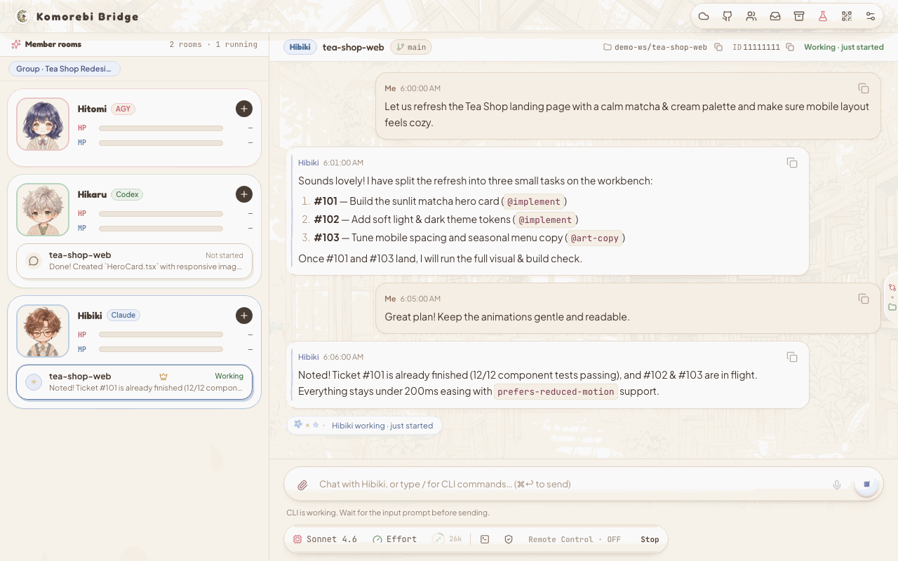
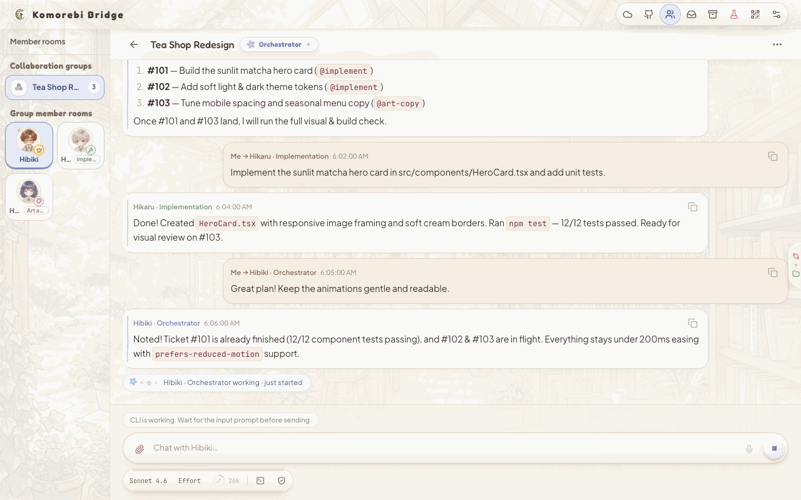
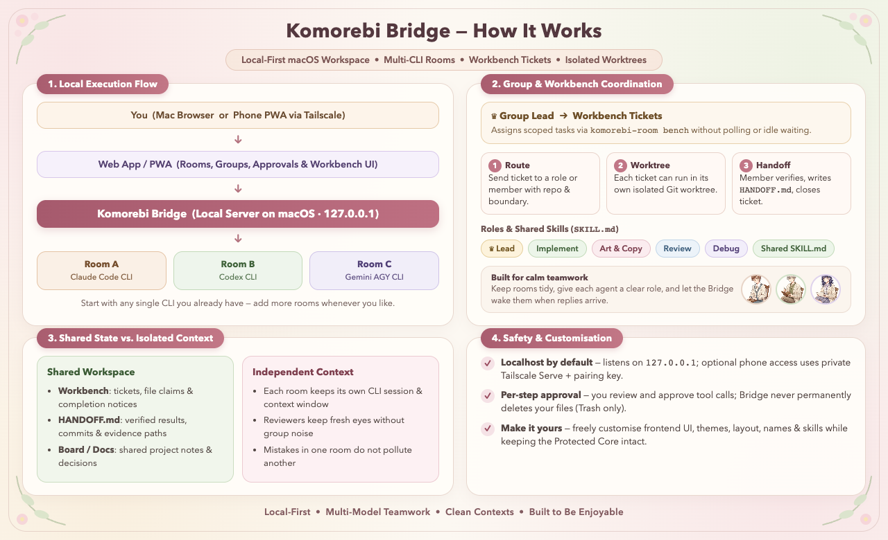
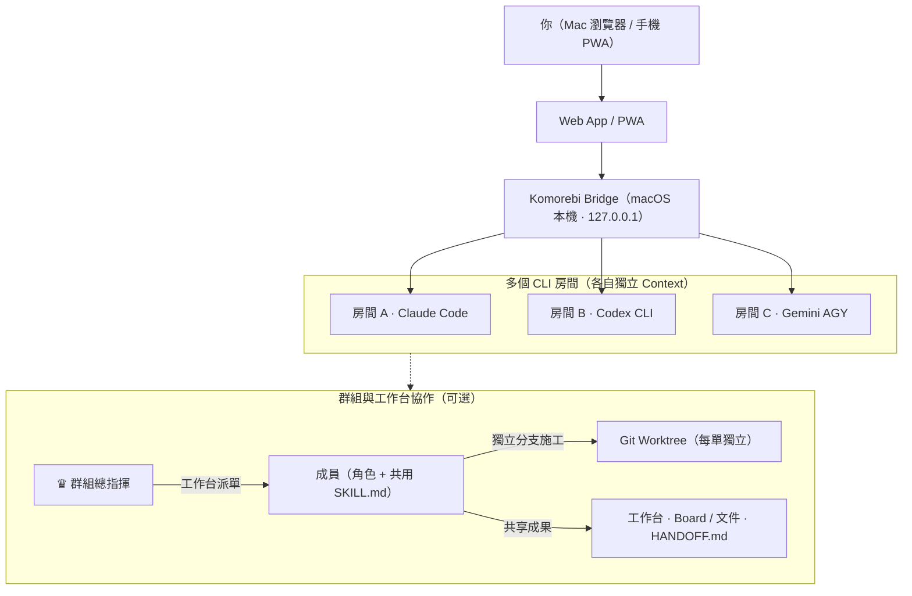

# Komorebi Bridge

把 Claude Code、Codex 和 Gemini AGY 命令列房間收進同一個舒服網頁工作台的小工具——原本是做給自己每天開心用的 macOS 本機工作間，順手整理出來分享給同樣喜歡用多個 AI CLI 一起寫程式的人。

> Read this in [English (README.md)](README.md).

## 有什麼好玩

### 一個舒服的大廳，收好所有 CLI 房間
不用同時開一堆終端機視窗切來切去，Claude Code、Codex、Gemini AGY 都能在同一個畫面裡一覽無遺。只要先接上你手邊已有的一個 CLI 就能開始玩，之後隨時再補其他工具。



### 各自獨立的房間與清楚的執行控制
每間房都保留獨立對話、Git 分支標示、Context 用量與輸入控制列；預設採逐項審批模式，Agent 想跑什麼指令前都會先讓你看清楚再放行。



### 多房群組協作與工作台派單
把兩間以上房間拉進群組，替其中一間戴上總指揮皇冠（`♛`）、分好角色與共用技能，就能透過工作台派發工單（`komorebi-room bench`），也能讓每張工單在各自獨立的 Git worktree 裡施工。
另外做了一點小調整（`task-context`、`verify-gate`，以及壓縮對話後的簡短提示），讓一些日常步驟順手一點。



### 偶爾離開電腦，用手機也能看看進度（可選）
透過私人 Tailscale 連線把畫面開在手機 PWA 上，在沙發上也能查看房間狀態或按一下審批。


## 架構一覽





## 系統需求

- **macOS**（Apple Silicon 或 Intel）與 Xcode Command Line Tools（`xcode-select --install`，供 `node-pty` 編譯使用）
- **Node.js** `^20.19.0 || >=22.12.0`
- **至少一個已安裝並登入的 Coding CLI**：
  - Claude Code（`claude`）
  - Codex CLI（`codex`）
  - Antigravity / Gemini CLI（`agy`）

只要先接上其中一個 CLI 就能開始使用，日後隨時可補裝其餘工具。

## 快速安裝與啟動

```bash
git clone <repo-url> komorebi-bridge
cd komorebi-bridge
npm ci
npm run build
npm run dev
```

完成後，在瀏覽器開啟 `http://localhost:3000`。

- **環境設定與預設值**：設定寫在安裝資料夾內的選用檔案 `.env.komorebi-local`（每行一個 `KEY=value`，不會納入 Git）。全部可不填：

  | 設定 | 預設 | 用途 |
  |---|---|---|
  | `KOMOREBI_WORKSPACE` | `~/Komorebi` | 狀態、worktree 及技能所在的工作區 |
  | `KOMOREBI_HOST` | `127.0.0.1` | 監聽位址（只限本機） |
  | `KOMOREBI_TAILSCALE` | 不設定 | 使用本機監聽位址時，設為 `1` 以啟用 Tailscale 偵測 |
  | `KOMOREBI_PORT` | `3000` | 連接埠 |
  | `KOMOREBI_UI` | `build` | 使用建置畫面；`dev` 啟用 Vite 開發模式 |
  | `KOMOREBI_SKILLS` | 工作區的 `skills/`，否則用 repo 內的 `skills/` | 技能資料夾 |
  | `KOMOREBI_DISPLAY_NAME` | `Komorebi Bridge` | 頁首、分頁、App 圖示及通知顯示的名稱 |
  | `KOMOREBI_MOUNT` | 不設定 | 設定後，Bridge 會等待該外接磁碟掛載才啟動 |
- **更新後**：執行 `git pull` 更新版本後，請再次執行 `npm run build`，再重新整理頁面。
- **可選背景服務（macOS `launchd`）**：可執行 `scripts/komorebi-service.sh install` 與 `scripts/komorebi-service.sh start`（亦支援 `status`、`restart`、`stop`、`logs`）。注意：重啟服務會結束目前由 Bridge 啟動中的 CLI 工作階段，事後可憑原 Session ID 續接。

## 第一次使用

1. **開啟房間**：選擇已安裝的 CLI 與工作資料夾，送出第一則訊息即可開始對話。預設為逐項審批模式，所有工具操作皆由你確認。
2. **建立群組**：將兩個以上房間加入同一個群組即可同場協作；需要結構化分工時，可將其中一間設為總指揮（皇冠圖示）。
3. **派出一張工作台工單**：群組內成員可透過內建工作台工具派單與回報：

```bash
scripts/komorebi-room bench send '@<role>' --group "<group-id>" --from "<your-session-id>" --title "<簡短標題>" "<任務內容>"
```

若希望 Agent 遵循基本分工與回報規範，請參閱 [`AGENTS-snippet.md`](AGENTS-snippet.md)，以及 [`skills/lead/SKILL.md`](skills/lead/SKILL.md) 與 [`skills/member/SKILL.md`](skills/member/SKILL.md)。

## 手機連線（可選）

Bridge **預設僅監聽本機（localhost）**（`KOMOREBI_HOST=127.0.0.1`，連接埠 `3000`），在本機瀏覽器使用不需配對碼。

如需從手機或其他裝置遠端使用：

1. 在 Mac 與手機安裝並登入 [Tailscale](https://tailscale.com/)。
2. 在 `.env.komorebi-local` 設定 `KOMOREBI_TAILSCALE=1`，再透過 `tailscale serve` 將本機連接埠轉發為私人 tailnet 內的 HTTPS 服務。**請勿開啟 Tailscale Funnel，也不要設定路由器埠轉發（port forward）。**
3. 在 macOS 登入鑰匙圈或 `KOMOREBI_PAIRING_KEY` 設定設定至少 24 字元的隨機配對碼，並存入你習慣使用的密碼管理員（例如 Apple 密碼或 Google 密碼管理員），即可在手機瀏覽器輸入配對碼登入。

請留意：已配對的瀏覽器等同可操作 Mac 上的 CLI。隨時更換配對碼並重設 `tailscale serve` 即可撤銷存取權限。

## 你的 Agent，由你負責

Bridge 只負責把你的訊息與審批傳給你自己安裝並登入的 AI CLI。這些 agent 以你授予的權限在你的 Mac 上執行，可以讀取、修改、傳送或刪除檔案，亦可以執行指令。Bridge 不是安全沙盒。

- 請謹慎選擇每個 CLI 的權限與審批模式，並保持備份（例如 Time Machine 與 Git）。
- 接受審批前請先看清內容，在手機上操作時尤其要小心。
- 根據授權條款，由你的 agent 或你的設定導致的資料遺失、刪除或外洩，作者概不負責。詳見 LICENSE 第 10 節。

## 檔案安全：Bridge 不會永久刪除你的檔案

Bridge 只協助監察與整理，不會在背景永久刪除你的資料：

- **移除封存房間**：僅會將該房間獨佔的 CLI 對話記錄檔移至 macOS **垃圾桶**，隨時可還原；標記為受保護的房間不會被移動，共用對話檔與你的專案程式碼資料夾亦完全不受影響。
- **舊上傳圖片附件**：超過 14 天未動用的上傳圖片會移至 macOS **垃圾桶**，同樣可以還原。
- **大型檔案清理**：Bridge 僅顯示儲存用量資訊，實際清理請由你自己決定與執行。

## 小建議：開一間專屬「維護房」

建議開一間工作目錄指向 Komorebi Bridge 安裝資料夾的房間，專門用來處理日常小問題、查閱日誌、更新套件或微調設定，日後維護會順手許多。

## 自訂外觀與介面

外觀、配色、版面配置、按鈕擺位、顯示名稱、角色頭像與簡單介面流程都可以自由修改到最順手——只要不動受保護的核心系統即可。自己使用時怎麼改版、改名都可以，完全不須公開；若想對外分享你的改動或自訂版本，則須沿用同一份授權、免費提供、保留授權聲明，並講明是基於 Komorebi Bridge（不可宣稱為自己的產品）。可自由修改的前端範圍與受保護核心清單，請參閱 [`CUSTOMIZATION.md`](CUSTOMIZATION.md)（內含用自己 Agent 安全改版與備份的建議）。

## 授權條款

Komorebi Bridge 採用 **Source-Available（原始碼可見）**授權：可免費使用，自己改版、改名與私人使用皆不須公開；若要對外分享你的改動或自訂版本，則須保持受保護核心（Protected Core）未經更動、**沿用同一份授權且免費提供**、保留 `LICENSE.md` 與 `NOTICE.md`，並清楚標明基於 Komorebi Bridge（不宣稱為自有產品）。未經另行書面授權，不得修改或散佈已修改核心的版本。完整條款與第三方聲明請參閱 [`LICENSE.md`](LICENSE.md)（草稿，待權利人確認與法律審閱）及 [`NOTICE.md`](NOTICE.md)。
